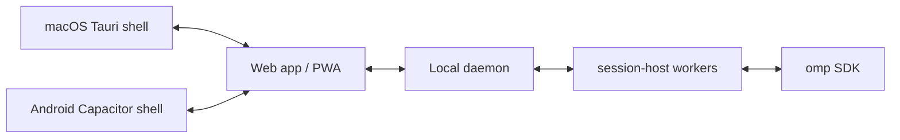

English | [中文](README.zh-CN.md)

# omp-console

A self-hosted control room for your omp coding agents: tiled panes and a live agent graph on your Mac, and the same sessions on your phone.

> **Unofficial project.** omp-console is an independent GUI; it is not an official oh-my-pi or Pi project.

## Screenshots

Captured from the local mock daemon with WebKit fixtures; no live agent or model calls.

| Desktop | Phone |
|---|---|
|  |  |
|  |  |

## Quick start

- **Install** on macOS, Linux, or native Windows 10/11: [step-by-step installation](docs/INSTALL.md).
- **Get started** after installation: [connect your browser, start a session, import Claude Code history, and connect your phone](docs/GETTING-STARTED.md).
- **Install with a coding agent**: use the prompt for omp, Claude Code, or Codex in [Install with a coding agent](docs/INSTALL-WITH-AN-AGENT.md).
- **Desktop apps** for macOS, Windows, and Linux: [download from Releases](https://github.com/LQ458/omp-console/releases). Install the service first.

The sections below are the short reference.

## Requirements

- macOS or Linux, or Windows 10/11 x64 natively (no WSL required). Native Tauri desktop apps exist for macOS, Windows, and Linux (`.deb` or AppImage); the daemon also works from any browser/PWA.
- Bun 1.4 or newer (`bun upgrade` if older: older releases cannot read the lockfile and build a blank web UI). The installer checks the version and uses that Bun for the build and the service; CI tests Bun 1.4.3.
- `omp` installed; the first-run checklist checks the executable, version, available model credentials, existing omp sessions, and Claude Code history. The installer does not inspect credentials or make model calls.
- Tailscale is optional for phone access; the supported remote path is Tailscale Serve.

For existing Claude Code or Codex conversations and setup, see [Migrate from Claude Code or Codex](docs/migrating-from-claude-code.md).

## Install on macOS

1. Install Bun and `omp`, then sign in to `omp` if you want to start model-backed sessions immediately. Existing omp sessions and settings are read from the agent/config directories used by your terminal.
2. Clone this repository from its GitHub page and enter the checkout.
3. Install and start the local daemon with `./scripts/install.sh --launchd`. For tailnet access, add the exact Tailscale DNS name: `./scripts/install.sh --launchd --allow-host '<machine>.<tailnet>.ts.net'` (optionally `--owner '<tailnet-login>'` to also require that login).

The installer builds the web UI, installs `~/.local/bin/omp-console`, and uses `~/.omp-console` for daemon state. In an interactive desktop terminal it opens a one-click pairing page; click **Pair this browser** to approve the device. Noninteractive installs print the exact next command. `./scripts/install.sh --uninstall` removes only the omp-console LaunchAgent.

## Install on Linux

Install the host prerequisites and Bun using your distribution's packages and the official Bun installer:

```sh
sudo apt-get install git curl unzip
curl -fsSL https://bun.sh/install | bash
```

Install `omp` if it is not already available. To sign in with a Claude subscription, run `omp`, then `/login`, and choose Anthropic. Clone this repository, enter it, enable a user service that survives logout, and install:

```sh
loginctl enable-linger "$USER"
./scripts/install.sh --systemd
```

The installer builds the web UI, installs `~/.local/bin/omp-console`, and starts a loopback-only user service. In an interactive desktop terminal it opens a one-click pairing page; click **Pair this browser**. If the installer is noninteractive, run `~/.local/bin/omp-console open` from a terminal after the service starts. Pair another device from Settings → Devices; Tailscale is optional for phone access, and `./ops/tailscale-serve.sh` is the supported tailnet path. Remove the user service with `./scripts/install.sh --uninstall`.

The service reads optional `~/.omp-console/env` (mode 0600) so its provider keys and `PI_CODING_AGENT_DIR`/`PI_CONFIG_DIR` can match terminal omp. The installer creates a commented template and captures the two PI directory variables when they are set and installation is not running as root; it never writes API keys. Add provider keys as literal `KEY=value` lines, then restart the service with `systemctl --user restart omp-console`. The daemon rejects symlinks, files owned by another user, modes other than 0600, and invalid lines.

To run without a service, run `./scripts/install.sh --plain` to build and install the CLI. The installer prints the exact daemon start command first; run it in a terminal, then run `~/.local/bin/omp-console open` to request a fresh pairing code and open the page.

`~/.local/bin/omp-console pair` prints a fresh code and one-click link in an interactive terminal. `open` always requests a fresh code and opens the browser when a desktop session is available; `status` checks the daemon and `logs` shows service logs. Pairing codes expire after 10 minutes and are also stored in `~/.omp-console/pairing-code`. On the first paired visit, the home screen checks your omp install, model sign-in, previous sessions, and Claude Code history. The `#pair=` fragment is removed before any pairing request; click **Pair this browser** to send the code.

### Pair a phone over Tailscale Serve

1. On the host, run `./ops/tailscale-serve.sh`. It forwards HTTPS port 7443 to the loopback daemon on port 7490 and prints the tailnet URL.
2. In the paired browser, open Settings → Devices → Pair another device to request a one-time code (valid for 10 minutes).
3. Open the HTTPS URL on the phone and click **Pair this browser**. Revoke devices in Settings → Devices.

Tailscale Serve is the only supported remote-access path. Do not use Tailscale Funnel. A reverse proxy needs its own authentication and is not a supported deployment.

## Install on Windows

On Windows 10/11 x64, install [Git for Windows](https://git-scm.com/download/win), then open PowerShell and install Bun and omp:

```powershell
powershell -c "irm bun.sh/install.ps1 | iex"
irm https://omp.sh/install.ps1 | iex
```

After reopening PowerShell, clone and install:

```powershell
git clone https://github.com/LQ458/omp-console.git "$HOME\omp-console"
Set-Location "$HOME\omp-console"
.\scripts\install.ps1
```

The installer builds the web UI and starts the per-user `omp-console` Scheduled Task; no WSL or administrator rights are needed. In an interactive PowerShell window it opens the pairing page. For the full guide, SmartScreen notes, update, and uninstall steps, see [docs/INSTALL.md](docs/INSTALL.md).

## Features

- Tiled session panes and a live nested-agent graph.
- Session creation, steering, status, and collaboration controls backed by omp.
- The new-session dialog shows recent projects and lets you browse from your home folder, type a path, or create a folder inside a configured project folder.
- Recent project folders come from saved omp sessions; terminal sessions appear in the sidebar and open as copies, and sessions in deleted folders remain available as read-only transcripts.
- Optional Overnight run keeps a session working until its deadline, retries recoverable failures, and produces a morning report; best-effort only, with platform-specific keep-awake support.
- Shared sessions on the host and phone, with a responsive PWA and optional Android WebView shell.
- Push notifications for supported session events, plus local transcript caching.
- A native desktop app for macOS, Windows, and Linux built with Tauri and the system WebView.

## Optional features

The optional daemon integrations are off by default. Enable them in **Settings → Advanced → Optional features**; the daemon shows missing requirements and whether a startup flag overrides the saved value. Alternatively edit `<state-dir>/config.json` or use the CLI flags documented in [daemon feature configuration](packages/daemon/README.md#feature-configuration).

| Feature | What it does | What it needs | How to enable |
|---|---|---|---|
| Project search | Session cards, return briefs, and project suggestions; searches in the background. | A Notes folder, at least one Project folder, and a model set up and signed in to omp. | Settings → Advanced → Optional features, `config.json`, or `--librarian on`. |
| Ask your notes | Searches selected note sources in the background. | A Notes folder, at least one source: SiYuan, Notes folder, web, or session history, and a model set up and signed in to omp. | Settings → Advanced → Optional features, `config.json`, or `--quick-ask on` with `--quick-ask-source`. |
| Task board | Connects a local task board to omp sessions. | A folder with the task board app’s files. | Settings → Advanced → Optional features, `config.json`, or `--agenda on` with `--agenda-hub`. |
| Other computers | Connects other omp-console computers. | A computer’s URL and ID, plus a token file from pairing; see [other computer token setup](packages/daemon/README.md#other-computer-token-files). | Settings → Advanced → Optional features, `config.json`, or `--peers on`. |
| OpenRouter model choices | Chooses models for Project search automatically. | Project search enabled and an OpenRouter API key saved in omp. | Settings → Advanced → Optional features, `config.json`, or `--openrouter-decisions on`. |
| Computer use | Lets an agent control the host Mac. | Accessibility and Screen Recording permission for the daemon process. | Settings → Advanced → Optional features, `config.json`, or `--computer-use on`. |
| Overnight run | Continues unfinished work, retries recoverable failures, and writes a morning report; best-effort only. | The daemon must stay running until the run ends. | Settings → Advanced → Optional features, `features.overnight: true`, or `--overnight on`. |

Overnight run is off by default. Existing config files without `features.overnight` leave it off; set that field to `true` or pass `--overnight on` to keep using it. No config migration runs.

## Architecture



The daemon binds to loopback. Tailscale Serve is an authenticated HTTPS proxy for phone access; the web UI and API remain same-origin.

## Security

The daemon is a remote-control interface to sessions running with the host user's privileges. Read the [threat model and reporting instructions](SECURITY.md) before enabling remote access. It does not isolate the daemon from other processes running as the same host user.

## License and acknowledgements

The omp-console code is MIT-licensed; see [LICENSE](LICENSE). The upstream omp license is included in [licenses/OMP-LICENSE](licenses/OMP-LICENSE). Third-party dependency notices are generated in [licenses/THIRD-PARTY-NOTICES.md](licenses/THIRD-PARTY-NOTICES.md) and served by the web app at `/licenses.txt`. The patches in `patches/` are derived from published omp package source and declarations; see [patches/README.md](patches/README.md).

omp-console is an independent GUI for [oh-my-pi (omp)](https://github.com/can1357/oh-my-pi) by Stencil Labs, derived from [Pi](https://github.com/badlogic/pi-mono) by Mario Zechner. It is not an official omp or Pi project. Its web UI started from omp's `collab-web` package.

Main libraries: Bun, React, Tauri, Capacitor, dockview, KaTeX, Mermaid, Lucide, and web-push.
