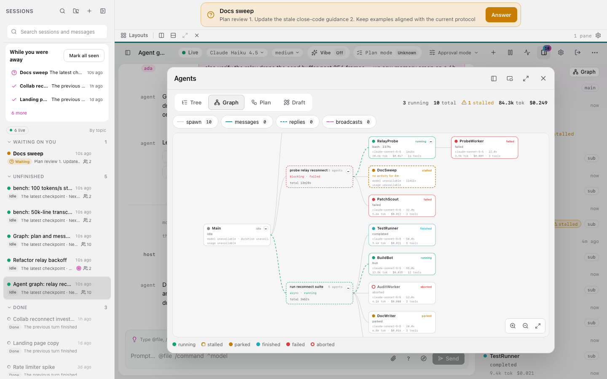
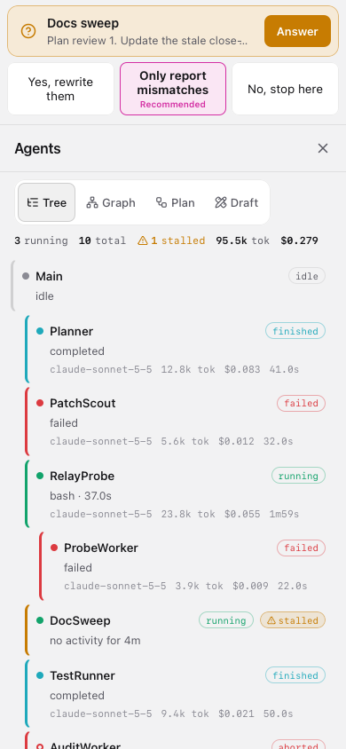
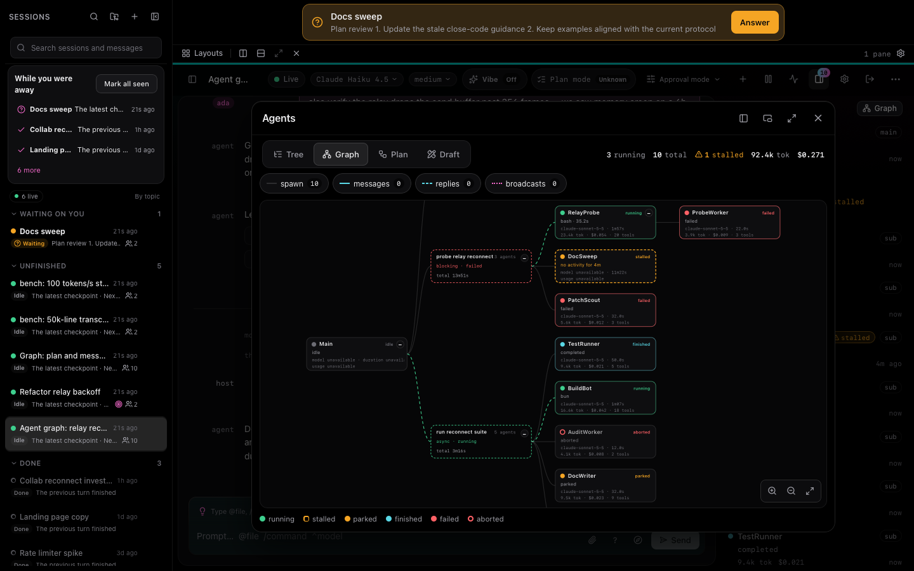
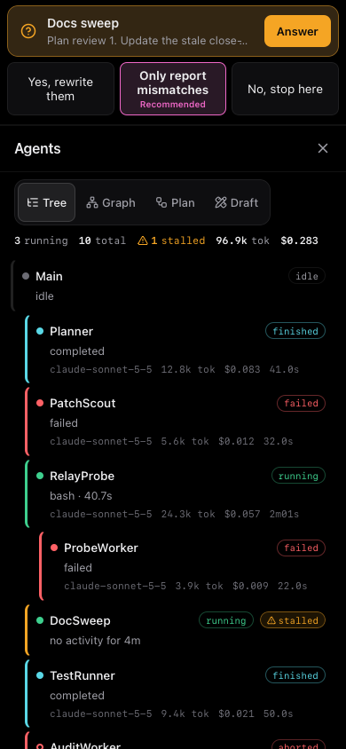

中文 | [English](README.md)

# omp-console

一个可自行托管的 omp 会话控制台：在桌面浏览器中查看会话与智能体活动，也可在手机上继续使用。omp-console 是独立项目，并非 oh-my-pi 或 Pi 官方产品。

## 截图

截图来自本地模拟服务，不涉及真实智能体或模型调用。

| 桌面 | 手机 |
|---|---|
|  |  |
|  |  |

## 快速开始

- [安装 omp-console](docs/zh-CN/INSTALL.md)：macOS、Linux 和原生 Windows 10/11 x64 的安装说明。
- [安装后入门](docs/zh-CN/GETTING-STARTED.md)：连接浏览器、创建第一个会话、导入旧对话以及连接手机。
- [让代码智能体代为安装](docs/zh-CN/INSTALL-WITH-AN-AGENT.md)：将中文提示词发给 omp、Claude Code、Codex 或其他代码智能体。
- [下载桌面应用](https://github.com/LQ458/omp-console/releases)：macOS、Windows 和 Linux 版本。桌面应用只是本机服务的窗口，请先安装服务。

## 支持的平台

服务可运行于 macOS、Linux 和 Windows 10/11 x64。也可通过浏览器使用；桌面应用提供 macOS、Windows 和 Linux 版本。手机远程访问使用 Tailscale。

## 许可证

omp-console 使用 MIT 许可证，详见 [LICENSE](LICENSE)。
